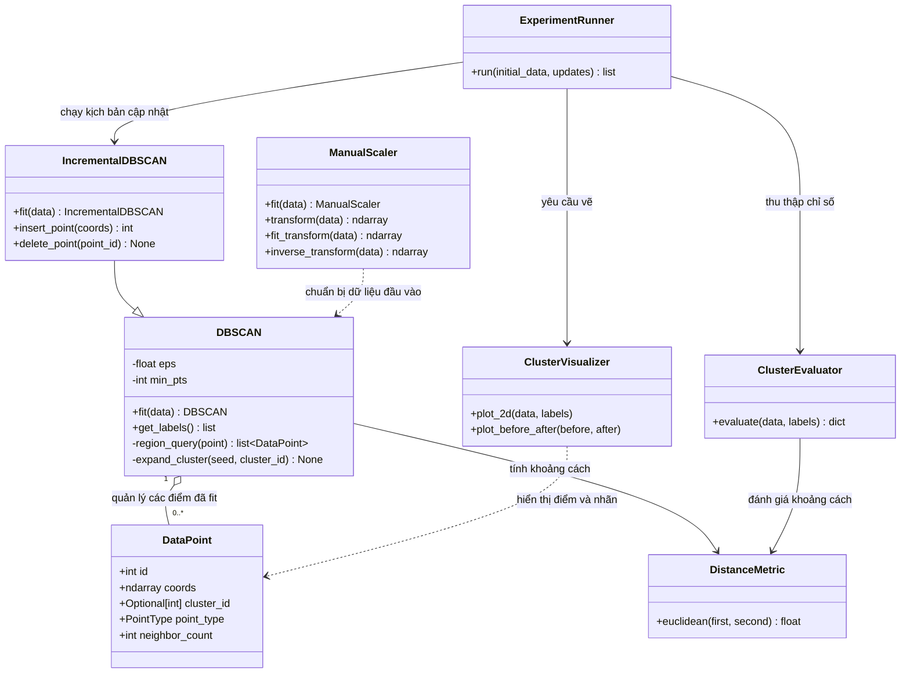

# Thiết kế lớp theo OOP (C02)

## Sơ đồ lớp

## Trách nhiệm và giao diện

| Lớp | Trách nhiệm | Giao diện chính |
|---|---|---|
| `DataPoint` | Lưu vector n-D, ID, nhãn cụm, loại điểm và số láng giềng. | `id`, `coords`, `cluster_id`, `point_type`, `neighbor_count` |
| `DistanceMetric` | Tính khoảng cách, độc lập với dữ liệu điểm và thuật toán gom cụm. | `euclidean(first, second)` |
| `ManualScaler` | Ước lượng tham số co giãn và biến đổi đặc trưng trước khi gom cụm. | `fit`, `transform`, `fit_transform`, `inverse_transform` |
| `DBSCAN` | Giữ tham số và thực hiện DBSCAN theo lô: tìm vùng lân cận, mở rộng cụm, gán nhãn. | `fit`, `get_labels` |
| `IncrementalDBSCAN` | Mở rộng DBSCAN với thao tác cập nhật điểm. | Kế thừa `fit`/`get_labels`; thêm `insert_point`/`delete_point` |
| `ClusterEvaluator` | Tính các chỉ số đánh giá từ dữ liệu và nhãn cụm. | `evaluate(data, labels)` |
| `ClusterVisualizer` | Vẽ dữ liệu 2D, nhãn cụm và trạng thái điểm. | `plot_2d`, `plot_before_after` |
| `ExperimentRunner` | Điều phối kịch bản chạy và thu thập kết quả. | `run(initial_data, updates)` |

`DBSCAN` và `IncrementalDBSCAN` dùng chung giao diện gồm `fit()` và
`get_labels()`; lớp incremental chỉ bổ sung các phương thức cập nhật. Mỗi lớp
có một trách nhiệm chính và chỉ phụ thuộc vào những giao diện cần thiết. Đây
là thiết kế cho C02; các nhiệm vụ sau chịu trách nhiệm cài đặt từng lớp và
thuật toán.

## Đối chiếu với mã nguồn hiện tại

Sơ đồ trên mô tả thiết kế mục tiêu của C02; mã nguồn hiện tại chưa có đủ các
lớp và chưa thống nhất toàn bộ tên lớp:

| Mã nguồn hiện tại | Lớp trong thiết kế C02 | Ghi chú |
|---|---|---|
| `Point` | `DataPoint` và `DistanceMetric` | `Point` hiện lưu dữ liệu điểm và tự tính khoảng cách; thiết kế tách hai trách nhiệm này. |
| `CustomDBSCAN` | `DBSCAN` | Cùng vai trò DBSCAN theo lô, khác tên lớp. |
| `IncrementalDBSCAN` | `IncrementalDBSCAN` | Đã có; hiện kế thừa `CustomDBSCAN`, còn sơ đồ chốt lớp cơ sở là `DBSCAN`. |
| Chưa có | `ManualScaler`, `ClusterEvaluator`, `ClusterVisualizer`, `ExperimentRunner` | Các lớp này mới được xác định trong thiết kế C02, chưa xuất hiện trong mã nguồn hiện tại. |

Vì vậy, không nên xem sơ đồ là mô tả chính xác các lớp đang có trong code.
Việc đổi tên hoặc tách lớp trong mã nguồn cần được thực hiện ở các task cài đặt
tương ứng; C02 chỉ chốt thiết kế và trách nhiệm lớp.
