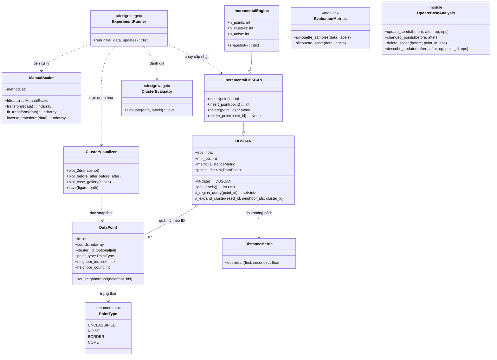

# Thiết kế lớp theo OOP (C02)

## Sơ đồ lớp khớp với mã nguồn hiện tại

Ký hiệu <<module>> chỉ nhóm hàm, không phải class Python. ClusterEvaluator và ExperimentRunner được giữ trong UML như hai lớp thiết kế của C02, nhưng hiện chưa có class Python tương ứng. Các thành phần gắn <<module>> thể hiện cách source đang đảm nhiệm một phần trách nhiệm đó.

## Trách nhiệm và giao diện

| Thành phần | Trách nhiệm | Mã nguồn / giao diện chính |
|---|---|---|
| DataPoint | Lưu ID ổn định, vector n chiều, nhãn, loại điểm và cache láng giềng. | src/core/data_point.py: id, coords, cluster_id, point_type, neighbor_ids, neighbor_count |
| PointType | Biểu diễn trạng thái chưa phân loại, nhiễu, biên và lõi. | src/core/data_point.py: UNCLASSIFIED, NOISE, BORDER, CORE |
| DistanceMetric | Tính khoảng cách Euclidean giữa hai vector cùng số chiều. | src/core/distance.py: euclidean(first, second) |
| ManualScaler | Fit tham số chuẩn hóa và biến đổi/nghịch biến đổi dữ liệu. | src/preprocessing/scaler.py: fit, transform, fit_transform, inverse_transform |
| DBSCAN | Fit DBSCAN theo lô, giữ điểm theo ID, truy vấn lân cận và mở rộng cụm. | src/clustering/dbscan.py: fit, get_labels, _region_query, _expand_cluster |
| IncrementalDBSCAN | Cập nhật cụm cục bộ khi thêm hoặc xóa điểm. | src/clustering/incremental_dbscan.py: insert, delete và các bí danh tương thích |
| IncrementalEngine | Bổ sung snapshot và thống kê số điểm/cụm để các phần thực nghiệm và vẽ dùng chung giao diện. | src/experiments/engine.py |
| ClusterVisualizer | Vẽ snapshot 2D; dữ liệu nhiều chiều được chiếu xuống 2D khi cần. | src/visualization/plotter.py: plot_2d, plot_before_after, plot_case_gallery, save |
| ClusterEvaluator | Lớp dự kiến gom các phép đánh giá kết quả phân cụm. | Chưa có class; hiện dùng hàm trong src/evaluation/metrics.py và src/evaluation/evaluation_library.py |
| ExperimentRunner | Lớp dự kiến điều phối tiền xử lý, cập nhật, đánh giá và trực quan hóa. | Chưa có class; hiện có IncrementalEngine, hàm chạy kịch bản ở src/visualization/scenarios.py và các lệnh thực nghiệm ở baseline/ |
| EvaluationMetrics | Các hàm đánh giá Silhouette tự cài, không dùng sklearn. | src/evaluation/metrics.py: silhouette_samples, silhouette_score |
| UpdateCaseAnalysis | Phân tích UpdSeed, điểm đổi trạng thái và phạm vi xử lý của delete. | src/experiments/update_cases.py |

## Hai tên class trong bản thiết kế trước

Bản thiết kế C02 yêu cầu có ClusterEvaluator và ExperimentRunner trong sơ đồ lớp. Hai class vẫn được giữ làm thiết kế mục tiêu, nhưng source hiện chưa định nghĩa chúng. Phần đánh giá hiện là các hàm trong src/evaluation/metrics.py và src/evaluation/evaluation_library.py; phần điều phối kỹ thuật gồm IncrementalEngine, các hàm chạy kịch bản trong src/visualization/scenarios.py và các lệnh thực nghiệm trong baseline/.

DBSCAN và IncrementalDBSCAN dùng chung fit() và get_labels(); lớp incremental bổ sung thao tác insert/delete. Mỗi class chịu trách nhiệm cho một phần riêng, còn phần đánh giá và chạy kịch bản được tổ chức theo module hàm.
