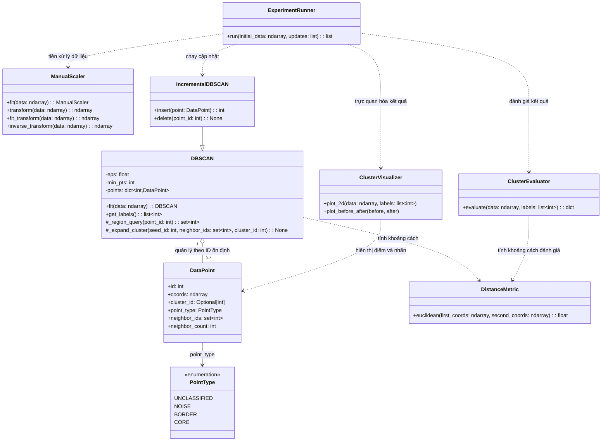

# Thiết kế lớp theo OOP (C02)

## Sơ đồ lớp

## Trách nhiệm và giao diện

| Lớp | Trách nhiệm | Giao diện chính |
|---|---|---|
| `DataPoint` | Lưu vector n-D, ID ổn định, nhãn cụm, loại điểm và cache ID láng giềng. | `id`, `coords`, `cluster_id`, `point_type`, `neighbor_ids`, `neighbor_count` |
| `PointType` | Liệt kê trạng thái chưa phân loại, nhiễu, biên và lõi của điểm. | `UNCLASSIFIED`, `NOISE`, `BORDER`, `CORE` |
| `DistanceMetric` | Tính khoảng cách giữa hai vector, độc lập với `DataPoint` và thuật toán gom cụm. | `euclidean(first_coords, second_coords)` |
| `ManualScaler` | Ước lượng tham số co giãn và biến đổi đặc trưng trước khi gom cụm. | `fit`, `transform`, `fit_transform`, `inverse_transform` |
| `DBSCAN` | Giữ tham số và thực hiện DBSCAN theo lô: tìm vùng lân cận, mở rộng cụm, gán nhãn. | `fit`, `get_labels` |
| `IncrementalDBSCAN` | Mở rộng DBSCAN với thao tác cập nhật điểm. | Kế thừa `fit`/`get_labels`; thêm `insert(point)`/`delete(point_id)` |
| `ClusterEvaluator` | Tính các chỉ số đánh giá từ dữ liệu và nhãn cụm. | `evaluate(data, labels)` |
| `ClusterVisualizer` | Vẽ dữ liệu 2D, nhãn cụm và trạng thái điểm. | `plot_2d`, `plot_before_after` |
| `ExperimentRunner` | Điều phối kịch bản chạy và thu thập kết quả. | `run(initial_data, updates)` |

`DBSCAN` và `IncrementalDBSCAN` dùng chung giao diện gồm `fit()` và
`get_labels()`; lớp incremental chỉ bổ sung các phương thức cập nhật. Mỗi lớp
có một trách nhiệm chính và chỉ phụ thuộc vào những giao diện cần thiết. Đây
là thiết kế cho C02; các nhiệm vụ sau chịu trách nhiệm cài đặt từng lớp và
thuật toán.

`DBSCAN` lưu điểm theo ID ổn định. Mỗi `DataPoint` giữ tập ID láng giềng;
`neighbor_count` được suy ra từ tập này để không bị lệch khi cache thay đổi.
Các phương thức cập nhật sau cần duy trì cache bằng ID, không bằng vị trí trong
danh sách.

## Phạm vi C02

Tài liệu này chỉ chốt sơ đồ lớp, trách nhiệm và giao diện dự kiến. Việc cài đặt
các lớp và thuật toán được thực hiện ở những task code riêng sau C02.
