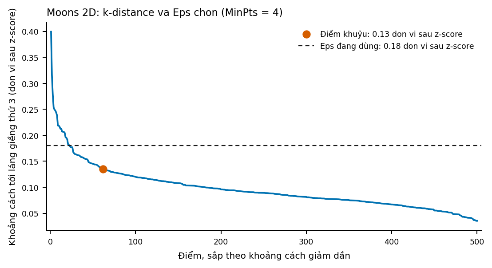
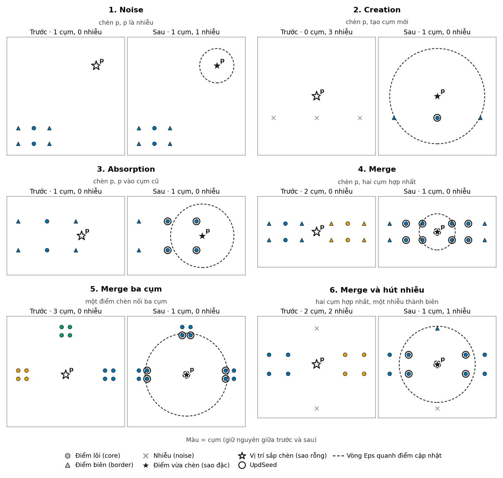
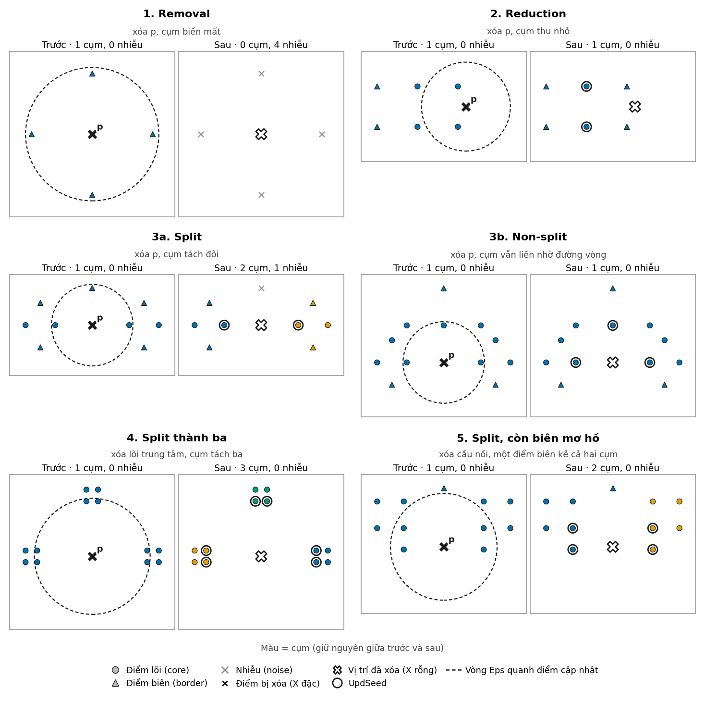

# Kết quả và thảo luận (V07)

> Bản thảo để tích hợp vào chương kết quả của báo cáo PDF. Số liệu thời gian bên dưới lấy từ các bảng kết quả hiện có trong repo và phụ thuộc máy chạy.

## 1. Độ đúng của cập nhật

Ở phép đối chiếu V04, 780 trạng thái sau cập nhật đều tương đương với DBSCAN của scikit-learn khi chạy lại trên toàn bộ dữ liệu: ARI bằng 1, tập điểm noise khớp và tập điểm core khớp theo tiêu chí của dự án. Đối chiếu bỏ qua các điểm biên đã được đánh dấu là mơ hồ, vì một điểm như vậy có thể hợp lệ ở hai cụm khác nhau.

Các thí nghiệm D05/D06 bổ sung 719 lần cập nhật được tổng hợp từ ba luồng ATM 2D, thẻ 5D và thẻ 5D khó. Tất cả nhóm tình huống trong `data/processed/experiments/d05_d06/case_summary.csv` đều ghi nhận kết quả tương đương với sklearn re-fit. Kết quả này cho thấy các tình huống insert và delete đã chọn được xử lý nhất quán; nó chưa chứng minh mọi cấu hình dữ liệu, Eps và MinPts đều đúng.

## 2. Chất lượng phân cụm và chọn tham số

V05 dùng 500 điểm hai chiều dạng hai nửa trăng. Chọn Eps = 0.18 và MinPts = 4: DBSCAN tự cài và sklearn đều tìm được 2 cụm, 9 điểm noise (1,8%), Silhouette khoảng 0,390 trên các điểm không-noise và ARI = 1 giữa hai cách cài. ARI so với nhãn sinh là khoảng 0,964.

Silhouette ở mức vừa phải không đồng nghĩa với phân cụm sai: Silhouette ưu tiên cụm gọn, gần lồi, trong khi hai nửa trăng có hình dạng phi lồi. Vì vậy cần đọc chỉ số này cùng tỷ lệ noise, hình dạng cụm và phép đối chiếu với nhãn tham chiếu; không dùng riêng Silhouette để chọn kết luận.

## 3. Insert, delete và thời gian chạy

Bảng dưới trích các nhóm tình huống đại diện từ `case_summary.csv`. Các giá trị là trung vị thời gian mỗi update, tính bằng mili giây; cột custom re-fit là một phép đo ở lần chạy này.

| Dữ liệu và tình huống | Incremental DBSCAN | sklearn re-fit | Custom DBSCAN re-fit | Nhận xét |
|---|---:|---:|---:|---|
| ATM 2D, insert Merge | 0,72 | 0,88 | 368,14 | Cập nhật cục bộ nhanh hơn cả hai cách re-fit trong nhóm này. |
| ATM 2D, delete PotentialSplit_Split | 4,49 | 0,90 | 376,30 | Tách cụm làm tăng chi phí xử lý vùng ảnh hưởng; sklearn vẫn nhanh hơn. |
| Thẻ 5D khó, delete Reduction | 68,56 | 1,37 | 419,56 | Trường hợp vùng ảnh hưởng lớn làm update chậm hơn đáng kể, dù vẫn thấp hơn custom re-fit. |

`stream_fit.csv` ghi một phép đo fit ban đầu riêng từ thí nghiệm D05/D06 trước đó; không gộp số đo này với benchmark V06 bên dưới vì số lượt và giao thức đo khác nhau. Benchmark V06 báo riêng thời gian fit D0 theo trung vị của 5 lượt trong `density_algorithm_benchmark_summary.csv`.

## 4. Thảo luận, giới hạn và trường hợp khó

- Kết quả đúng trên các bộ dữ liệu mô phỏng và tình huống đã lưu; cần thận trọng khi khái quát sang dữ liệu thực có mật độ, nhiễu và phân phối khác.
- Delete có thể phải kiểm tra lại nhiều điểm để xác định cụm còn liên thông hay đã tách. Số điểm bị xét lại lớn làm lợi thế cập nhật cục bộ giảm, như nhóm delete Reduction trên thẻ 5D khó.
- Bản custom viết bằng Python thuần chậm hơn nhiều so với cài đặt sklearn đã tối ưu. Vì thế báo cáo phân biệt rõ so sánh với custom re-fit và với sklearn re-fit.
- Eps/MinPts đã chọn cho bộ moons chỉ là cấu hình minh họa cho bộ đó; không phải cặp tham số dùng chung cho ATM, giao dịch thẻ và mọi dữ liệu n chiều.
- Dữ liệu thí nghiệm là dữ liệu mô phỏng. ARI so với nhãn sinh phản ánh mức khớp với cách sinh dữ liệu, không thay thế đánh giá trên dữ liệu thực.

## 5. Benchmark bốn thuật toán qua nhiều lượt

Benchmark V06 phát lại cùng D0 và 20 cập nhật đầu tiên của mỗi stream trong 5 lượt, có 1 lượt warm-up fit D0 không tính vào số liệu. Các lần chạy được xáo thứ tự thuật toán theo seed 42. Bảng dưới ghi **trung vị ± độ lệch chuẩn** của tổng thời gian insert/delete trong 20 bước, tính bằng mili giây. Đây là kết quả trên máy Windows 11, Python 3.14.2, scikit-learn 1.9.1; thời gian phụ thuộc máy.

| Stream (Eps, MinPts) | Incremental DBSCAN OOP | sklearn DBSCAN | sklearn HDBSCAN | sklearn OPTICS |
|---|---:|---:|---:|---:|
| ATM 2D (0,5; 4) | 80,40 ± 1,75 | 70,36 ± 2,58 | 237,00 ± 16,58 | 11.519,48 ± 227,23 |
| Thẻ 5D (0,4; 6) | 125,48 ± 4,19 | 125,94 ± 2,48 | 153,65 ± 4,25 | 10.752,59 ± 308,89 |
| Thẻ 5D khó (0,3; 6) | 991,16 ± 26,80 | 97,15 ± 2,09 | 148,85 ± 7,40 | 10.560,39 ± 255,55 |

Mỗi lần insert/delete của Incremental DBSCAN gọi cập nhật vùng ảnh hưởng. Ba adapter scikit-learn thay đổi tập điểm rồi chạy lại estimator trên toàn bộ tập hiện tại; do đó thời gian của chúng phản ánh **refit mỗi bước**, không phải thuật toán incrementally cập nhật. Trong 20 bước này, bản OOP gần ngang sklearn DBSCAN ở stream thẻ 5D, nhưng chậm hơn ở ATM và đặc biệt ở stream thẻ khó, nơi một số lần xóa có vùng ảnh hưởng lớn. Kết quả không ủng hộ khẳng định rằng Incremental DBSCAN luôn nhanh hơn bản thư viện.

Độ khớp nhãn với Incremental DBSCAN OOP, đo bằng ARI trung bình qua các bước cập nhật, lần lượt trên ba stream ATM / thẻ 5D / thẻ 5D khó:

| Phương pháp | ATM 2D | Thẻ 5D | Thẻ 5D khó |
|---|---:|---:|---:|
| Incremental DBSCAN OOP | 1,000 | 1,000 | 1,000 |
| sklearn DBSCAN | 1,000 | 1,000 | 1,000 |
| sklearn HDBSCAN | 0,963 | 0,987 | 0,513 |
| sklearn OPTICS | 0,274 | 0,017 | 0,034 |

DBSCAN dùng `eps`/`MinPts` của mỗi stream và sklearn `min_samples=MinPts`. HDBSCAN dùng `min_cluster_size=MinPts`, `min_samples=MinPts`, `cluster_selection_method='eom'`; OPTICS dùng `min_samples=MinPts`, `max_eps=inf`, `cluster_method='xi'`, `xi=0.05`. `MinPts` chỉ là tham số tham chiếu gần nhất cho hai thuật toán sau; chúng có định nghĩa và cách trích cụm riêng, nên khác biệt ARI không tự nó chứng minh thuật toán kém chất lượng. OPTICS có thời gian cao trong cấu hình `max_eps=inf` và trích cụm `xi`; đây là so sánh một cấu hình công bố, chưa phải tối ưu tham số từng thuật toán.

Kết quả từng bước/lượt, một dòng cho mỗi lượt/phương pháp, thống kê tổng hợp và thông tin môi trường nằm tại `results/density_algorithm_benchmark_runs.csv`, `results/density_algorithm_benchmark_repeats.csv`, `results/density_algorithm_benchmark_summary.csv` và `results/density_algorithm_benchmark_README.txt`. Hình so sánh thời gian nằm tại `report/figures/density_algorithm_benchmark.png`. Do chỉ dùng prefix 20 bước, không suy rộng kết quả này ra toàn bộ các stream 119/300 bước.

## 6. Ghi chú trước khi chốt số liệu hiệu năng

Các CSV/hình D09 hiện có chưa được tạo lại sau khi mã benchmark đổi sang chạy lặp cho sweep theo số update. `data/processed/experiments/d09/README.txt` ghi rõ phần sweep theo m còn dựa trên phép đo cũ/một lần và yêu cầu chạy lại. Vì vậy không dùng các đường cong D09 hiện tại để đưa ra kết luận định lượng cuối cùng về độ phức tạp hoặc xu hướng theo kích thước dữ liệu; cần cập nhật chúng sau khi benchmark D09 được chạy lại.
